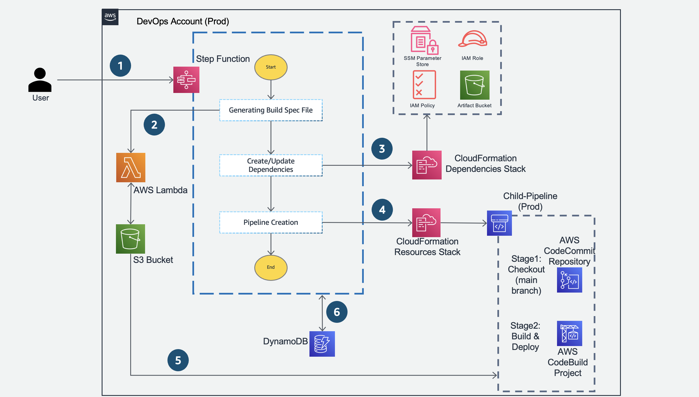

# Automated CI Pipeline Creation

> **Disclaimer:** This is sample code for non-production usage. Work with your security and legal teams to meet your organizational security, regulatory and compliance requirements before deployment. See [SECURITY.md](SECURITY.md) for the services used, permissions, accepted trade-offs and clean-up steps.


## Summary

As the technology stack diversifies and the volume of development activities increases, Organisations find it difficult to have standardised CI Pipelines leveraging the AWS developer tools and AWS best practices.

This pattern depicts the creation of Continuous Integration pipelines dynamically using an AWS Step Function based approach to create standardised pipelines for an organisation. This approach ensures that all pipelines in the organisation are consistent and standardised. The solution takes the technology stack (java, python) , pipeline name, stages required for the pipeline etc., as input and generates the CI pipelines leveraging AWS Step Functions, AWS Lambda, AWS CloudFormation, Amazon S3 and Amazon DynamoDB.

## **Prerequisites**

-   An AWS account.

-   S3 bucket to maintain the templates required by this solution.

-   An IAM user with required permissions to setup the solution for creation of pipelines using CloudFormation.


## **Limitations**

-   The AWS IAM Roles used in this solution follows the principle of least privilege and is configured with the minimum access for this platform to function. The role should be updated as per requirement.

-   This solution currently supports the automated creation of CI pipelines for Java and Python projects only.

## **Target architecture**



The workflow of the above architecture is as follows:

1.  A user provides the input parameters in JSON format to start execution of the Step Function.

2.  The Lambda function validates the inputs. It then reads the reference fragments from the `input-references` folder in the S3 bucket and assembles a `buildspec.yml` file for the selected stages. The file is written back to the S3 bucket under `generated-artifacts/<tech_stack>/<project_name>/`, and it defines the stages of the CI pipeline.

3.  The Step Function checks for any creation or updates to the dependencies for the pipeline to be created and performs the required action as needed.

4.  The Step Function then creates the pipeline resources as a CloudFormation stack.

5.  The sample source code for the selected technology stack, together with the generated `buildspec.yml`, is pushed into a CodeCommit repository, which the pipeline uses as its source.

6.  DynamoDB (encrypted with a KMS key) stores the pipeline details and status during the execution. If the input is not valid or a stack fails, the execution ends in the failed state and the item is updated to "Pipeline creation failed".

## **Tools**

-   [AWS Step Function](https://aws.amazon.com/step-functions/) - AWS Step Functions is a visual workflow service that helps developers use AWS services to build distributed applications, automate processes, orchestrate micro services, and create data and machine learning (ML) pipelines.

-   [AWS Lambda](https://aws.amazon.com/lambda/) - AWS Lambda is a serverless, event-driven compute service that lets you run code for virtually any type of application or backend service without provisioning or managing servers. You can trigger Lambda from over 200 AWS services and software as a service (SaaS) applications, and only pay for what you use.

-   [AWS CodeBuild](https://aws.amazon.com/codebuild/) – AWS CodeBuild is a fully managed continuous integration service that compiles source code, runs tests, and produces software packages that are ready to deploy.

-   [AWS CodeCommit](https://aws.amazon.com/codecommit/) – AWS CodeCommit is a fully-managed source-control service that hosts secure Git-based repositories

-   [AWS CodePipeline](https://aws.amazon.com/codepipeline/) – AWS CodePipeline is a fully managed continuous delivery service that helps you automate your release pipelines for fast and reliable application and infrastructure updates.

-   [AWS Identity and Access Management (IAM)](https://aws.amazon.com/iam/) – AWS IAM helps you to manage access to AWS services and resources securely.

-   [AWS KMS – AWS Key Management Service (AWS KMS)](https://aws.amazon.com/kms/) – AWS KMS helps to create and manage cryptographic keys and control their use across a wide range of AWS services and in your applications.

-   [Amazon S3](https://aws.amazon.com/s3/) – Amazon Simple Storage Service (Amazon S3) is storage for the internet.

-   [AWS CloudFormation](https://docs.aws.amazon.com/AWSCloudFormation/latest/UserGuide/Welcome.html) - AWS CloudFormation is a service that helps you model and set up your AWS resources so that you can spend less time managing those resources and more time focusing on your applications that run in AWS.

-   [Amazon DynamoDB](https://aws.amazon.com/dynamodb/) - Amazon DynamoDB is a fully managed, serverless, key-value NoSQL database designed to run high-performance applications at any scale. DynamoDB offers built-in security, continuous backups, automated multi-Region replication, in-memory caching, and data import and export tools.

-   [SSM Parameter Store](https://docs.aws.amazon.com/systems-manager/latest/userguide/systems-manager-parameter-store.html) - Parameter Store, a capability of AWS Systems Manager, provides secure, hierarchical storage for configuration data management and secrets management. You can store data such as passwords, database strings, Amazon Machine Image (AMI) IDs, and license codes as parameter values.

-   [Python](https://www.python.org/) - Python is a programming language that lets you work quickly and integrate systems more effectively.

## Best practices

-   If Secrets are involved in a pipeline or action configuration, such as tokens or passwords, do not enter secrets directly in the action configuration or CloudFormation configuration because the information will be displayed in the logs. Use Secrets Manager to set up and store secrets, and then reference this secret in the pipeline or action configuration as needed.

-   Configure server-side encryption for artifacts stored in Amazon S3 for CodePipeline by managing AWS KMS keys. Refer  [documentation](https://docs.aws.amazon.com/codepipeline/latest/userguide/S3-artifact-encryption.html)

-   Ensure Principal of least Privilege while setting up IAM roles to be used by the Pipelines

-   Ensure that your Amazon S3 buckets use the correct policies and are not publicly accessible

-   Use versioning to preserve, retrieve, and restore every version of every object stored in your Amazon S3 bucket.

-   Use IAM Access Analyzer to perform checks and get actionable recommendations to help you author secure and functional policies.

-   To the extent that it's practical, define the conditions under which your IAM policies allow access to a resource.

-   Enable logging and monitoring

-   Review the tests results to find those that are routinely ignored can identify potential for streamlining your test coverage.

## Solution Deployment

1. Creation of S3 bucket for maintaining the templates used by this solution
    - Login to the AWS Account and Navigate to the S3 service page.
    - Create a S3 bucket for hosting the Cloud Formation templates, Source Code and input files. For the detailed instructions for creating S3 bucket refer the [documentation](https://docs.aws.amazon.com/AmazonS3/latest/userguide/creating-bucket.html)
        -  Note: This can be ignored if the bucket is already available

2. Clone the Code Repository to the local workstation
    - Use the HTTPS URL of this repository: https://github.com/aws-samples/automated-ci-pipeline-creation.git
    - Open the terminal on your local system and run the below commands,


        -  mkdir working-directory
        -  cd working-directory
        -  git clone https://github.com/aws-samples/automated-ci-pipeline-creation.git

3. Upload the Solution templates and artifacts into the S3 bucket
    - Login to the AWS Account and navigate to the S3 console.
    - Select the S3 Bucket which you have created in pre-requisite step for storing the solution templates.
    - Copy the contents from the Solution-Templates folder which you cloned locally and upload them into the S3 bucket.
        -  Note: Copy only the contents within the folder “Solution-Templates“

4. Create the CloudFormation stack for deploying the solution resources for CI pipeline creation
    - Sign into the AWS Management Console and navigate to the AWS CloudFormation service console.
    - Click on **Create stack** and in the drop down select **With new resources (standard)**
    - In the next screen, under **Specify template** section select **Upload a template file**
    - Select **Choose file** and navigate to the root folder of the cloned repository in your local workstation and select **template.yml** and click on **Open**
    - Click **Next**
    - In the Specify stack details, provide the details,
      -  **S3TemplateBucketName** - Name of the S3 bucket to which the template zip files, source code and input files where uploaded to.
      -  **DynamoDBTable** - Name of the DynamoDBTable that you want to create with
      -  **StateMachineName** - Name of the State Machine that you want to create with

    - In the Configure stack options click **Next**
    - In the Review page **select the check box** to acknowledge and click **Create Stack**.
      -  Wait for the stack to show CREATE_COMPLETE status and the main pipeline components are now successfully

## Run the state machine
1. Open the Step Functions console, select the state machine that you named in **StateMachineName**, and choose **Start execution**.
2. Enter the input in JSON format, for example:
```json
{
  "tech_stack": "java",
  "project_name": "my-java-ci",
  "pre_build": "yes",
  "build": "yes",
  "post_build": "yes",
  "reports": "yes"
}
```
   Use `"tech_stack": "python"` for a Python project.
3. Wait for the execution to succeed. The generated pipeline is named `<project_name>-Pipeline`, with the CodeCommit repository `<project_name>-Repo` and the CodeBuild project `<project_name>-Build`. The pipeline has the stages `CodeCheckout` and `Build`, and it starts when the repository is created.
## Authors and acknowledgment
- Aromal Raj Jayarajan
- Amarnath Reddy Patnam
- Mahesh Raghunandanan
- Vijesh Vijayakumaran Nair

## Notes
-   The solution supports Java and Python projects only. The sample projects use Java 17 (Amazon Corretto) and Python 3.12 on the Amazon Linux 2023 CodeBuild image (`aws/codebuild/amazonlinux-x86_64-standard:5.0`). The Java sample uses a `SecurityManager` in its tests, so it can't run on JDK 18 or later.
-   Deploy one copy of the solution in each account and Region. The IAM role and policy names (`Codebuild-Role-<Region>` and others) are fixed because the state machine role is limited to them.
-   The state machine accepts `tech_stack` (`java` or `python`), `project_name` (1 to 40 letters, numbers or hyphens), and `yes` or `no` for `pre_build`, `build`, `post_build` and `reports`. `reports` only applies when `build` is `yes`. If an input is not valid, or a stack fails, the execution ends in the failed state and the DynamoDB item shows "Pipeline creation failed".
-   The generated `buildspec.yml` is stored in the template bucket under `generated-artifacts/<tech_stack>/<project_name>/`, together with a zip file of the sample code and the buildspec that seeds the CodeCommit repository.
-   The generated pipelines only run the CI stages of your buildspec. They don't deploy anything.
-   AWS CodeCommit is the source of the generated pipelines.

## Clean up
1. Delete the `<project_name>-Stack` CloudFormation stack of each generated pipeline.
2. Empty the `deployment-artifact-bucket-...` bucket and the `deployment-artifact-bucket-logs-...` bucket, including all object versions (both have versioning turned on). Then delete the `pipeline-creation-dependencies-stack` stack. If the deletion fails because the log bucket received new objects, empty it again and retry.
3. Delete the stack that you created from `template.yml`. The KMS key that it creates goes into a pending deletion period (30 days by default).
4. Delete the S3 template bucket. Delete the CodeBuild report groups and CloudWatch log groups (`/aws/codebuild/<project_name>-Build`) that CodeBuild created for each project, and the Lambda log group `/aws/lambda/<stack name>-AWSLambdaFunction-...`, which Lambda creates and the stack does not delete.

## Security

See [CONTRIBUTING](CONTRIBUTING.md#security-issue-notifications) for more information.

## License

This library is licensed under the MIT-0 License. See the [LICENSE](LICENSE) file.

